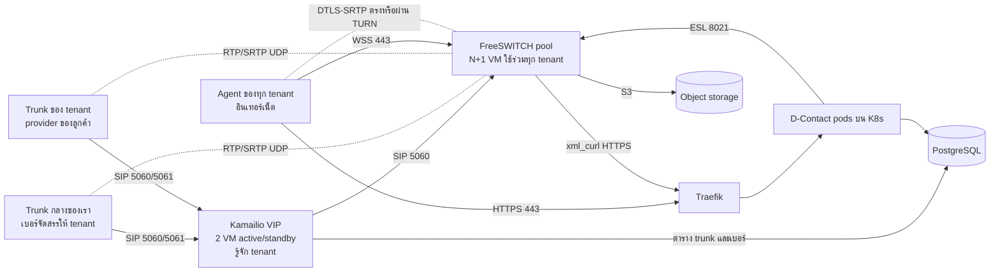
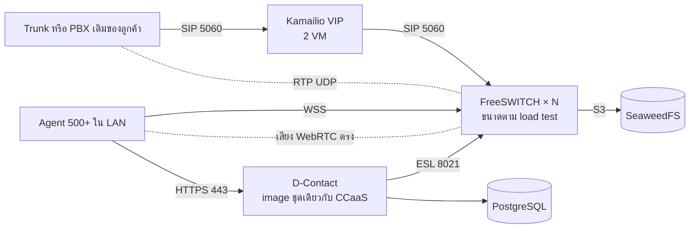

# แบบเครือข่ายและการติดตั้ง Voice (CCaaS และ on-prem)

สถานะ: **ข้อเสนอสำหรับทีม Infra ยังไม่ได้ติดตั้งและยังไม่ได้ทดสอบ** การตัดสินใจหลักอยู่ใน [ADR-038](adr/038-single-voice-stack-tenant-trunks.md) ผังภาพฉบับเต็มอยู่ที่ [ผังเครือข่าย D-Contact Voice](https://claude.ai/artifact/2qRf2g1RtLetwAc9hVYZ2V)
ค่าที่มาจากระบบจริงในเอกสารนี้มีเฉพาะ K8s worker `10.136.1.21–23`, PostgreSQL `10.136.2.11:4567`, พอร์ต SIP 5060, WSS 7443 และ ESL 8021 ค่าอื่น เช่น ชื่อ VLAN ช่วง RTP ชื่อโหนด และพอร์ต TURN เป็นค่าที่เสนอและต้องยืนยันกับทีม Infra

## หลักการ

- แอป D-Contact รันบน K8s ส่วน Kamailio และ FreeSWITCH รันบน VM นอก cluster เพราะ RTP ต้องเปิดพอร์ต UDP เป็นช่วงกว้าง และสายที่คุยอยู่หลุดเมื่อ pod ถูกย้าย
- สาย PSTN ทุกสายเข้าออกผ่าน Kamailio ส่วนเสียงวิ่งตรงระหว่าง trunk กับ FreeSWITCH
- ใช้ stack และ image ชุดเดียวกันทั้ง CCaaS และ on-prem ไม่ใช้ Asterisk

## CCaaS: หลาย tenant บน cloud ของเรา

### โซนเครือข่าย

| โซน | มีอะไร | ใครเข้าได้ |
| --- | --- | --- |
| SIP Edge | VIP และ Kamailio 2 VM | เฉพาะ IP ของ provider ที่ whitelist |
| Media | FreeSWITCH ทุกตัว และ TURN | RTP จาก provider และ Agent, SIP จาก Kamailio เท่านั้น |
| App | K8s worker | ผู้ใช้ผ่าน HTTPS 443 ที่ Traefik |
| Data / Mgmt | PostgreSQL, object storage, bastion, monitoring | เฉพาะโซน App, SIP Edge, Media และผู้ดูแล |

### Trunk ต่อ tenant

| เรื่อง | Trunk กลางของเรา | Trunk ของ tenant |
| --- | --- | --- |
| เจ้าของเบอร์ | เรา จัดสรรเบอร์ให้ tenant | ลูกค้า ผูกกับ tenant เดียว |
| รู้ tenant ของสายเข้าจาก | เบอร์ปลายทาง | IP ต้นทางหรือบัญชีที่ลงทะเบียน |
| สายออกใช้เมื่อ | tenant ไม่มี trunk ของตัวเอง | เป็น tenant เจ้าของ trunk เท่านั้น |
| ยืนยันตัว | whitelist IP | whitelist IP หรือ Kamailio ลงทะเบียนไปหา provider |

กติกาที่ Kamailio บังคับ: เบอร์ต้นทางของสายออกต้องเป็นของ tenant นั้น ห้ามออก trunk ของ tenant อื่น มีเพดานสายพร้อมกันและอัตราโทรออกต่อ tenant และปฏิเสธสายเข้าที่ระบุ tenant ไม่ได้

provider ของลูกค้าแต่ละรายต้อง whitelist IP ขาออกของเรา จึงต้องมี IP สาธารณะคงที่ชุดเดียวที่ VIP ของ Kamailio

### พอร์ตที่ต้องเปิด

| จาก | ไป | พอร์ต | ใช้ทำอะไร | ข้ามขอบ DC |
| --- | --- | --- | --- | --- |
| Provider ทุกราย | VIP ของ Kamailio | 5060 UDP/TCP, 5061 TLS | SIP ของสายเข้าและออก | ใช่ whitelist IP |
| Kamailio | Provider ที่ต้องลงทะเบียน | 5060 UDP/TCP, 5061 TLS | ลงทะเบียน trunk ของ tenant | ใช่ ขาออก |
| Provider ทุกราย | FreeSWITCH ทุกตัว | 16384–32768 UDP | เสียง RTP/SRTP | ใช่ whitelist IP |
| Agent | FreeSWITCH ทุกตัว | 443 TCP → 7443 | SIP over WSS ผ่าน TLS proxy บน VM | ใช่ |
| Agent | FreeSWITCH ทุกตัว | 16384–32768 UDP | เสียง WebRTC | ใช่ |
| Agent | TURN | 3478 UDP/TCP, 5349 TLS | relay เสียงเมื่อ UDP ตรงไม่ได้ | ใช่ |
| ผู้ใช้ทุกบทบาท | Traefik | 443 TCP | Console, Workspace, API | ใช่ |
| Kamailio | FreeSWITCH ทุกตัว | 5060 UDP/TCP | กระจายสายและตรวจสถานะ | ไม่ |
| Kamailio | PostgreSQL | 4567 TCP | อ่านตาราง trunk และเบอร์ | ไม่ |
| K8s worker ทุกตัว | FreeSWITCH ทุกตัว | 8021 TCP | ESL จาก `apps/telephony` | ไม่ |
| FreeSWITCH ทุกตัว | Traefik ภายใน | 443 TCP | xml_curl ดึง directory และ dialplan | ไม่ |
| FreeSWITCH ทุกตัว | Object storage | S3 HTTPS | อัปโหลดไฟล์บันทึกเสียง | ไม่ |
| K8s worker ทุกตัว | PostgreSQL | 4567 TCP | ฐานข้อมูลของแอป | ไม่ |
| Bastion / VPN | VM ทุกตัว | 22 TCP | ดูแลระบบ | ไม่ |

ESL ACL ของ FreeSWITCH ต้องอนุญาต IP ของ K8s worker ทุกตัว เพราะ pod ออกนอก cluster ด้วย IP ของ worker ช่วง RTP ของ UAT E1 ปัจจุบันคือ `16384-16420` ซึ่งรองรับได้ราว 9 สายพร้อมกัน ต้องขยายก่อนใช้งานจริง

## On-prem: ติดตั้งในไซต์ลูกค้า 500+ Agent

สิ่งที่ต่างจาก CCaaS:

| เรื่อง | CCaaS | On-prem |
| --- | --- | --- |
| จำนวน tenant | หลาย tenant | tenant เดียว |
| Trunk | trunk กลางและ trunk ของ tenant | trunk หรือ PBX เดิมของลูกค้า |
| ตำแหน่ง Agent | อินเทอร์เน็ต | LAN ของลูกค้า |
| TURN | ต้องมี | ไม่ต้องมี |
| การต่ออินเทอร์เน็ต | ต้องมี | ไม่ต้องมี รองรับไซต์ที่ตัดอินเทอร์เน็ต |
| License | แผนและ entitlement ของแพลตฟอร์ม | ไฟล์ license ตรวจออฟไลน์ ([licensing.md](licensing.md)) |
| ที่รันแอป | K8s ของเรา | K8s ขนาดเล็กที่ส่งไปพร้อมชุดติดตั้ง หรือ Docker Compose บน VM |
| Object storage | ตาม ADR-029 | SeaweedFS ตาม ADR-029 |
| Image | registry ของเรา | registry ออฟไลน์ในไซต์ |

ลูกค้าที่มี PBX เดิม รวมถึง Asterisk เชื่อมเข้ามาเป็น SIP trunk ที่ Kamailio D-Contact ไม่ควบคุม PBX นั้นโดยตรง

ขนาดเครื่องยังกำหนดไม่ได้ 500 Agent อาจหมายถึงสายพร้อมกันหลายร้อยสายพร้อมบันทึกเสียง ต้อง load test ด้วยจำนวนสายพร้อมกัน codec และการบันทึกเสียงตามจริงก่อนเสนอสเปกให้ลูกค้า

## พฤติกรรมเมื่อเครื่องล่ม

- Kamailio ตัว active ล่ม: VIP ย้ายไปตัว standby สายที่ตั้งสายเสร็จแล้วเสียงยังเดินต่อเพราะเสียงไม่ผ่าน Kamailio แต่คำสั่ง SIP กลางสายของสายนั้นอาจล้มเหลว
- FreeSWITCH ตัวใดล่ม: สายที่คุยอยู่บนตัวนั้นหลุด สายใหม่ไปตัวที่เหลือ Agent ที่ลงทะเบียนกับตัวนั้นต้องลงทะเบียนใหม่กับโหนดอื่น
- K8s pod ของ `apps/telephony` ถูกย้าย: สายที่คุยอยู่ไม่หลุด แต่การสั่งงานสายหยุดจนกว่า pod ใหม่ต่อ ESL กลับได้

## ลำดับทดสอบ

1. FreeSWITCH ตัวเดียวกับ Agent และ Router ซึ่งทำได้แล้วบน UAT E1
2. เพิ่ม Kamailio หน้า FreeSWITCH ตัวเดียว ใช้ trunk จำลอง
3. เพิ่ม tenant ที่สองและ trunk ที่สอง ตรวจกติกาแยก tenant ทั้งสายเข้าและสายออก
4. เพิ่ม FreeSWITCH ตัวที่สอง ปิดตัวแรกแล้วตรวจการกระจายสายใหม่
5. ต่อ trunk ของ provider จริง ตรวจ NAT เสียงทางเดียว และ SRTP
6. Load test ตามจำนวนสายพร้อมกันเป้าหมาย

## ต้องยืนยันก่อนติดตั้ง

- CIDR ของ VLAN SIP Edge และ Media, IP ของ VIP, Kamailio, FreeSWITCH แต่ละตัว และ IP สาธารณะขาออก
- Provider กลางของเราเชื่อมผ่านอินเทอร์เน็ตหรือวงจรเฉพาะ รองรับ SRTP และ SIP TLS หรือไม่
- จะเปิด FreeSWITCH รับเสียงจากอินเทอร์เน็ตโดยตรง หรือวาง rtpengine คั่นหน้า (ยังไม่ตัดสิน)
- จำนวนสายพร้อมกันสูงสุดของ CCaaS ระยะแรก และของลูกค้า on-prem แต่ละราย
- รูปแบบชุดติดตั้ง on-prem: K8s ขนาดเล็กหรือ Docker Compose
- ข้อกำหนดทางกฎหมายของการให้บริการเบอร์โทรศัพท์แก่ tenant ต้องตรวจกับ provider และฝ่ายกฎหมาย
