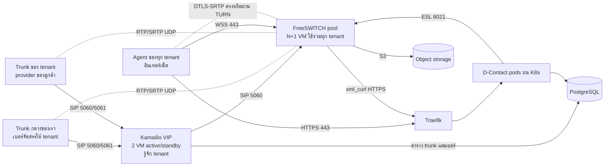
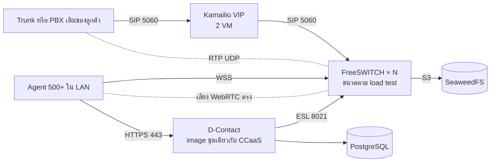
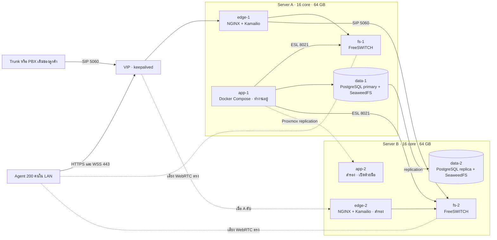
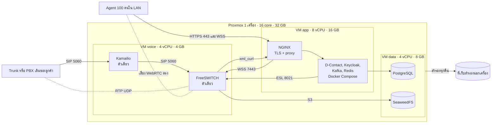

# แบบเครือข่ายและการติดตั้ง Voice (CCaaS และ on-prem)

สถานะ: **ข้อเสนอสำหรับทีม Infra ยังไม่ได้ติดตั้งและยังไม่ได้ทดสอบ** การตัดสินใจหลักอยู่ใน [ADR-038](adr/038-single-voice-stack-tenant-trunks.md) ผังภาพฉบับเต็มอยู่ที่ [ผังเครือข่าย D-Contact Voice](https://claude.ai/artifact/2qRf2g1RtLetwAc9hVYZ2V)
ค่าที่มาจากระบบจริงในเอกสารนี้มีเฉพาะ K8s worker `10.136.1.21–23`, PostgreSQL `10.136.2.11:4567`, พอร์ต SIP 5060, WSS 7443 และ ESL 8021 ค่าอื่น เช่น ชื่อ VLAN ช่วง RTP ชื่อโหนด และพอร์ต TURN เป็นค่าที่เสนอและต้องยืนยันกับทีม Infra

## หลักการ

- แอป D-Contact รันบน K8s ส่วน Kamailio และ FreeSWITCH รันบน VM นอก cluster เพราะ RTP ต้องเปิดพอร์ต UDP เป็นช่วงกว้าง และสายที่คุยอยู่หลุดเมื่อ pod ถูกย้าย
- สาย PSTN ทุกสายเข้าออกผ่าน Kamailio ส่วนเสียงวิ่งตรงระหว่าง trunk กับ FreeSWITCH
- ใช้ stack และ image ชุดเดียวกันทั้ง CCaaS และ on-prem ไม่ใช้ Asterisk

## CCaaS: หลาย tenant บน cloud ของเรา

### โซนเครือข่าย

| โซน | มีอะไร | ใครเข้าได้ |
| --- | --- | --- |
| SIP Edge | VIP และ Kamailio 2 VM | เฉพาะ IP ของ provider ที่ whitelist |
| Media | FreeSWITCH ทุกตัว และ TURN | RTP จาก provider และ Agent, SIP จาก Kamailio เท่านั้น |
| App | K8s worker | ผู้ใช้ผ่าน HTTPS 443 ที่ Traefik |
| Data / Mgmt | PostgreSQL, object storage, bastion, monitoring | เฉพาะโซน App, SIP Edge, Media และผู้ดูแล |

### Trunk ต่อ tenant

| เรื่อง | Trunk กลางของเรา | Trunk ของ tenant |
| --- | --- | --- |
| เจ้าของเบอร์ | เรา จัดสรรเบอร์ให้ tenant | ลูกค้า ผูกกับ tenant เดียว |
| รู้ tenant ของสายเข้าจาก | เบอร์ปลายทาง | IP ต้นทางหรือบัญชีที่ลงทะเบียน |
| สายออกใช้เมื่อ | tenant ไม่มี trunk ของตัวเอง | เป็น tenant เจ้าของ trunk เท่านั้น |
| ยืนยันตัว | whitelist IP | whitelist IP หรือ Kamailio ลงทะเบียนไปหา provider |

กติกาที่ Kamailio บังคับ: เบอร์ต้นทางของสายออกต้องเป็นของ tenant นั้น ห้ามออก trunk ของ tenant อื่น มีเพดานสายพร้อมกันและอัตราโทรออกต่อ tenant และปฏิเสธสายเข้าที่ระบุ tenant ไม่ได้

provider ของลูกค้าแต่ละรายต้อง whitelist IP ขาออกของเรา จึงต้องมี IP สาธารณะคงที่ชุดเดียวที่ VIP ของ Kamailio

### พอร์ตที่ต้องเปิด

| จาก | ไป | พอร์ต | ใช้ทำอะไร | ข้ามขอบ DC |
| --- | --- | --- | --- | --- |
| Provider ทุกราย | VIP ของ Kamailio | 5060 UDP/TCP, 5061 TLS | SIP ของสายเข้าและออก | ใช่ whitelist IP |
| Kamailio | Provider ที่ต้องลงทะเบียน | 5060 UDP/TCP, 5061 TLS | ลงทะเบียน trunk ของ tenant | ใช่ ขาออก |
| Provider ทุกราย | FreeSWITCH ทุกตัว | 16384–32768 UDP | เสียง RTP/SRTP | ใช่ whitelist IP |
| Agent | FreeSWITCH ทุกตัว | 443 TCP → 7443 | SIP over WSS ผ่าน TLS proxy บน VM | ใช่ |
| Agent | FreeSWITCH ทุกตัว | 16384–32768 UDP | เสียง WebRTC | ใช่ |
| Agent | TURN | 3478 UDP/TCP, 5349 TLS | relay เสียงเมื่อ UDP ตรงไม่ได้ | ใช่ |
| ผู้ใช้ทุกบทบาท | Traefik | 443 TCP | Console, Workspace, API | ใช่ |
| Kamailio | FreeSWITCH ทุกตัว | 5060 UDP/TCP | กระจายสายและตรวจสถานะ | ไม่ |
| Kamailio | PostgreSQL | 4567 TCP | อ่านตาราง trunk และเบอร์ | ไม่ |
| K8s worker ทุกตัว | FreeSWITCH ทุกตัว | 8021 TCP | ESL จาก `apps/telephony` | ไม่ |
| FreeSWITCH ทุกตัว | Traefik ภายใน | 443 TCP | xml_curl ดึง directory และ dialplan | ไม่ |
| FreeSWITCH ทุกตัว | Object storage | S3 HTTPS | อัปโหลดไฟล์บันทึกเสียง | ไม่ |
| K8s worker ทุกตัว | PostgreSQL | 4567 TCP | ฐานข้อมูลของแอป | ไม่ |
| Bastion / VPN | VM ทุกตัว | 22 TCP | ดูแลระบบ | ไม่ |

ESL ACL ของ FreeSWITCH ต้องอนุญาต IP ของ K8s worker ทุกตัว เพราะ pod ออกนอก cluster ด้วย IP ของ worker ช่วง RTP ของ UAT E1 ปัจจุบันคือ `16384-16420` ซึ่งรองรับได้ราว 9 สายพร้อมกัน ต้องขยายก่อนใช้งานจริง

## On-prem: ติดตั้งในไซต์ลูกค้า 500+ Agent

สิ่งที่ต่างจาก CCaaS:

| เรื่อง | CCaaS | On-prem |
| --- | --- | --- |
| จำนวน tenant | หลาย tenant | tenant เดียว |
| Trunk | trunk กลางและ trunk ของ tenant | trunk หรือ PBX เดิมของลูกค้า |
| ตำแหน่ง Agent | อินเทอร์เน็ต | LAN ของลูกค้า |
| TURN | ต้องมี | ไม่ต้องมี |
| การต่ออินเทอร์เน็ต | ต้องมี | ไม่ต้องมี รองรับไซต์ที่ตัดอินเทอร์เน็ต |
| License | แผนและ entitlement ของแพลตฟอร์ม | ไฟล์ license ตรวจออฟไลน์ ([licensing.md](licensing.md)) |
| ที่รันแอป | K8s ของเรา | K8s ขนาดเล็กที่ส่งไปพร้อมชุดติดตั้ง หรือ Docker Compose บน VM |
| Object storage | ตาม ADR-029 | SeaweedFS ตาม ADR-029 |
| Image | registry ของเรา | registry ออฟไลน์ในไซต์ |

ลูกค้าที่มี PBX เดิม รวมถึง Asterisk เชื่อมเข้ามาเป็น SIP trunk ที่ Kamailio D-Contact ไม่ควบคุม PBX นั้นโดยตรง

ขนาดเครื่องยังกำหนดไม่ได้ 500 Agent อาจหมายถึงสายพร้อมกันหลายร้อยสายพร้อมบันทึกเสียง ต้อง load test ด้วยจำนวนสายพร้อมกัน codec และการบันทึกเสียงตามจริงก่อนเสนอสเปกให้ลูกค้า

## On-prem ขนาดกลาง: สองเครื่อง 200 Agent 70 สายพร้อมกัน

เงื่อนไข: เครื่องจริง 2 เครื่อง เครื่องละ CPU 16 core RAM 64 GB รัน Proxmox ใช้ NGINX และ Docker Compose ไม่ใช้ K8s สมมติว่าสเปกที่ให้มาเป็นของแต่ละเครื่อง

**ข้อจำกัดหลัก: สองเครื่องสลับเองได้เฉพาะฝั่งเสียงและ NGINX** ฐานข้อมูลและแอปต้องสลับด้วยมือ เพราะสองเครื่องตัดสินไม่ได้ว่าอีกฝั่งดับจริงหรือแค่เครือข่ายระหว่างกันขาด ถ้าปล่อยให้สลับเอง ทั้งสองฝั่งอาจรับข้อมูลพร้อมกันจนข้อมูลแตกเป็นสองชุด การสลับเองทั้งระบบต้องมีเครื่องที่สามเป็นเสียงตัดสิน

### การแบ่งทรัพยากรต่อเครื่อง

ทั้งสองเครื่องวาง VM ชุดเดียวกัน เพื่อให้เครื่องใดเครื่องหนึ่งรับงานทั้งหมดได้เมื่ออีกเครื่องดับ

| VM | vCPU | RAM | บน Server A | บน Server B |
| --- | --- | --- | --- | --- |
| edge | 2 | 2 GB | NGINX และ Kamailio ถือ VIP | สำรอง รับ VIP เมื่อ A ดับ |
| fs | 4 | 8 GB | FreeSWITCH รับสายอยู่ | FreeSWITCH รับสายอยู่ |
| app | 6 | 24 GB | Docker Compose ทำงานอยู่ | สำรอง ปิดไว้ เปิดด้วยมือ |
| data | 4 | 16 GB | PostgreSQL primary และ SeaweedFS | PostgreSQL replica และ SeaweedFS |
| Proxmox host | ใช้ร่วม | 4 GB | | |
| รวม | 16 | 54 GB | เหลือ RAM สำรอง 10 GB | เหลือ RAM สำรอง 10 GB |

ตัวเลขเป็นค่าเริ่มต้นที่ยังไม่ได้วัดจริง ต้อง load test ที่ 70 สายพร้อมกันบนเครื่องเดียวก่อนส่งมอบ เพราะ FreeSWITCH แต่ละตัวต้องรับ 70 สายได้คนเดียวเมื่ออีกเครื่องดับ ถ้า VM app ต้องการ CPU มากกว่า 6 ให้เพิ่มเป็น 8 โดยยอม overcommit เฉพาะ VM ที่ไม่ใช่ fs

ข้อกำหนดเพิ่มจากแบบเครื่องเดียว:

- สองเครื่องอยู่ใน L2 เดียวกันเพื่อให้ VIP ย้ายได้ และมีสายตรงระหว่างเครื่องสำหรับ replication แยกจากเครือข่ายของ Agent
- VM app สำรองด้วย Proxmox storage replication ไป Server B ซึ่งต้องใช้ ZFS ทั้งสองเครื่อง ข้อมูลใน Kafka และ Redis ที่เกิดหลังรอบ replication ล่าสุดจะหายเมื่อสลับ ต้องกำหนดรอบให้ลูกค้ายอมรับได้
- PostgreSQL ใช้ streaming replication ไป data-2 ส่วน SeaweedFS ตั้งให้เก็บสำเนาทั้งสองเครื่อง
- Kamailio บน edge ที่ถือ VIP กระจายสายไป fs-1 และ fs-2 และตรวจสถานะทั้งคู่
- NGINX ส่งต่อ WSS ไป FreeSWITCH ตามโหนดที่ D-Contact กำหนดให้ Agent แต่ละคน
- VM fs ตั้ง CPU type เป็น `host` ปิด memory ballooning และไม่ overcommit เช่นเดียวกับแบบเครื่องเดียว

### เมื่อเครื่องใดเครื่องหนึ่งดับ

| เหตุการณ์ | ผล | สลับเอง |
| --- | --- | --- |
| Server B ดับ | สายบน fs-2 หลุด สายใหม่ไป fs-1 ระบบทำงานต่อ แต่ไม่มีสำเนาข้อมูลจนกว่า B กลับมา | ใช่ |
| Server A ดับ: VIP, NGINX, Kamailio | ย้ายไป edge-2 ในไม่กี่วินาที สายบน fs-1 หลุด | ใช่ |
| Server A ดับ: แอปและฐานข้อมูล | Agent รับงานไม่ได้จนกว่าผู้ดูแลเลื่อน data-2 เป็น primary และเปิด app-2 | ไม่ ต้องทำด้วยมือ |
| สายระหว่างสองเครื่องขาด | ทั้งสอง edge อาจถือ VIP พร้อมกัน ต้องมีทางตรวจสถานะสำรองผ่านเครือข่ายอีกเส้น | ต้องออกแบบกัน |

เวลาที่ใช้สลับด้วยมือยังไม่ได้วัด ต้องเขียนขั้นตอนและซ้อมกับลูกค้าก่อนส่งมอบ ถ้าลูกค้าเพิ่มเครื่องที่สามขนาดเล็ก (ราว 2 vCPU 4 GB) เป็นเสียงตัดสิน จะทำให้ Proxmox HA และฐานข้อมูลสลับเองได้ ซึ่งเป็นงานออกแบบเพิ่ม

### พอร์ตและดิสก์

พอร์ตภายในไซต์เหมือนแบบเครื่องเดียวด้านล่าง โดย Agent และ trunk ชี้ที่ VIP แทน IP ของ VM และเพิ่มสามเส้นระหว่างเครื่อง: VRRP ของ keepalived ระหว่าง edge, PostgreSQL replication ระหว่าง data และ Proxmox replication ระหว่าง host

70 สายพร้อมกันใช้พอร์ต RTP ราว 280 พอร์ตต่อ FreeSWITCH เปิดช่วง 16384–17383 UDP ต่อตัว

เพดานไฟล์เสียงต่อวัน: 70 สาย × 8 ชั่วโมง = 33,600 นาที ถ้าเก็บเป็น WAV mono 8 kHz 16-bit จะใช้ไม่เกินราว 32 GB ต่อวัน หรือราว 2.9 TB สำหรับ 90 วัน และต้องมีพื้นที่เท่ากันทั้งสองเครื่องเพราะเก็บสองสำเนา ยังต้องสำรองออกนอกเครื่องเช่นเดียวกับแบบเครื่องเดียว เพราะสองสำเนาไม่กันการลบผิดหรือข้อมูลเสีย

## On-prem ขนาดเล็ก: เครื่องเดียว 100 Agent 20 สายพร้อมกัน

เงื่อนไข: เครื่องจริง 1 เครื่อง CPU 16 core RAM 32 GB รัน Proxmox ใช้ NGINX และ Docker Compose ไม่ใช้ K8s โครงตามแบบ UAT 3 VM ใน [ADR-030](adr/030-uat-three-vm-topology.md) แต่ทั้งสาม VM อยู่บนเครื่องเดียวกัน

**ข้อจำกัดหลัก: ไม่มีเครื่องสำรอง** เมื่อเครื่องนี้ดับ ทั้งระบบและทุกสายหยุดจนกว่าเครื่องกลับมา แบบนี้ลดความเสียหายได้ด้วยการสำรองข้อมูลออกนอกเครื่องเท่านั้น ลูกค้าต้องรับเงื่อนไขนี้เป็นลายลักษณ์อักษรก่อนติดตั้ง

### การแบ่งทรัพยากร

| ส่วน | vCPU | RAM | รันอะไร |
| --- | --- | --- | --- |
| Proxmox host | ใช้ร่วม | 4 GB | hypervisor เท่านั้น ไม่รันงานอื่น |
| VM voice | 4 | 4 GB | Kamailio และ FreeSWITCH แบบ Docker host network |
| VM app | 8 | 16 GB | NGINX และ Docker Compose ของ D-Contact, Keycloak, Kafka, Redis |
| VM data | 4 | 8 GB | PostgreSQL และ SeaweedFS |
| รวม | 16 | 32 GB | ไม่เหลือ RAM สำรอง |

ตัวเลขนี้เป็นค่าเริ่มต้นที่ยังไม่ได้วัดจริง ฐานอ้างอิงเดียวที่มีคือ VM2 ของ UAT ซึ่งรัน Keycloak, API และ object storage ได้ใน RAM 7.9 GB ด้วย `mem_limit` ต่อ container VM app ต้องกำหนด `mem_limit` ทุก container เช่นเดียวกัน และต้อง load test ที่ 20 สายพร้อมกันก่อนส่งมอบ

ข้อกำหนดบน Proxmox:

- VM voice ตั้ง CPU type เป็น `host` ปิด memory ballooning ใช้ NIC แบบ virtio และไม่ overcommit CPU ของ VM นี้ เพราะเสียงสะดุดเมื่อ CPU ถูกแย่ง
- ถ้าใช้ ZFS ต้องจำกัด ARC ให้อยู่ในงบ 4 GB ของ host มิฉะนั้น RAM ไม่พอสำหรับ VM
- ดิสก์ของ VM data อยู่บน RAID ที่ทนดิสก์เสียได้หนึ่งลูก เพราะไม่มีเครื่องที่สอง
- แยก bridge หรือ VLAN เป็น voice, app/data และ mgmt

### สิ่งที่ลดจากแบบ on-prem เต็ม

| เรื่อง | แบบ 500+ Agent | แบบเครื่องเดียว |
| --- | --- | --- |
| Kamailio | 2 VM ถือ VIP | ตัวเดียว ไม่มี VIP |
| FreeSWITCH | N+1 | ตัวเดียว |
| ที่รันแอป | K8s ขนาดเล็กหรือ Compose | Docker Compose บน VM เดียว |
| Kafka, Redis, Keycloak | ตามแบบของชุดติดตั้ง | อย่างละตัวเดียว |
| PostgreSQL | มี replica | ตัวเดียว พึ่งการสำรองข้อมูล |
| Image | registry ออฟไลน์ | ไฟล์ image นำเข้าด้วย `docker load` ไม่ตั้ง registry |

Kamailio ยังอยู่แม้มี FreeSWITCH ตัวเดียว เพื่อให้ config และกติกา trunk เป็นชุดเดียวกับทุก profile ตาม ADR-038 และเพิ่ม FreeSWITCH ตัวที่สองได้ภายหลังโดยไม่เปลี่ยนที่อยู่ที่ trunk ชี้มา

### พอร์ตภายในไซต์

| จาก | ไป | พอร์ต | ใช้ทำอะไร |
| --- | --- | --- | --- |
| Trunk หรือ PBX ของลูกค้า | VM voice (Kamailio) | 5060 UDP/TCP | SIP |
| Trunk หรือ PBX ของลูกค้า | VM voice (FreeSWITCH) | 16384–16683 UDP | เสียง RTP |
| Agent | VM app (NGINX) | 443 TCP | Console, Workspace, API และ WSS |
| Agent | VM voice (FreeSWITCH) | 16384–16683 UDP | เสียง WebRTC |
| VM app (NGINX) | VM voice | 7443 TCP | ส่งต่อ WSS |
| VM app | VM voice | 8021 TCP | ESL |
| VM voice | VM app (NGINX) | 443 TCP | xml_curl |
| VM app | VM data | PostgreSQL และ S3 | ข้อมูลของแอป |
| VM voice | VM data | S3 | ไฟล์บันทึกเสียง |
| ผู้ดูแล | Proxmox และทุก VM | 8006 TCP, 22 TCP | ดูแลระบบ จาก VLAN mgmt เท่านั้น |

20 สายพร้อมกันใช้พอร์ต RTP ราว 80 พอร์ต ช่วง 300 พอร์ตข้างบนจึงเพียงพอ

### ดิสก์ไฟล์บันทึกเสียง

เพดานต่อวันคำนวณจากสายพร้อมกันสูงสุด: 20 สาย × 8 ชั่วโมง = 9,600 นาที ถ้าเก็บเป็น WAV mono 8 kHz 16-bit (ราว 0.96 MB ต่อนาที) จะใช้ไม่เกินราว 9.2 GB ต่อวัน หรือราว 830 GB สำหรับ 90 วัน ค่าจริงต่ำกว่านี้ตามสัดส่วนเวลาที่สายเต็ม ต้องยืนยันรูปแบบไฟล์ที่บันทึกจริง จำนวนชั่วโมงทำงาน และอายุการเก็บกับลูกค้าก่อนกำหนดขนาดดิสก์

### การสำรองข้อมูลและการกู้คืน

- สำรอง PostgreSQL ทุกคืนและไฟล์เสียงใน SeaweedFS ไปที่เก็บนอกเครื่อง เช่น NAS ของลูกค้า
- สำรอง VM ทั้งสามด้วย Proxmox backup ไปที่เก็บเดียวกัน เพื่อกู้คืนลงเครื่องใหม่ได้
- ซ้อมกู้คืนลงเครื่องทดสอบอย่างน้อยหนึ่งครั้งก่อนส่งมอบ เวลากู้คืนจริงยังไม่ได้วัด
- ใช้ UPS และตั้งให้ VM เปิดเองตามลำดับ data, app, voice เมื่อเครื่องกลับมา

### เมื่อโตขึ้น

เพิ่มเครื่องที่สองแล้วย้ายไปแบบสองเครื่อง: เพิ่ม Kamailio และ FreeSWITCH ตัวที่สองพร้อม VIP และ PostgreSQL replica การสลับฐานข้อมูลเองโดยอัตโนมัติต้องมีเครื่องที่สามเป็นเสียงตัดสิน

## พฤติกรรมเมื่อเครื่องล่ม

- Kamailio ตัว active ล่ม: VIP ย้ายไปตัว standby สายที่ตั้งสายเสร็จแล้วเสียงยังเดินต่อเพราะเสียงไม่ผ่าน Kamailio แต่คำสั่ง SIP กลางสายของสายนั้นอาจล้มเหลว
- FreeSWITCH ตัวใดล่ม: สายที่คุยอยู่บนตัวนั้นหลุด สายใหม่ไปตัวที่เหลือ Agent ที่ลงทะเบียนกับตัวนั้นต้องลงทะเบียนใหม่กับโหนดอื่น
- K8s pod ของ `apps/telephony` ถูกย้าย: สายที่คุยอยู่ไม่หลุด แต่การสั่งงานสายหยุดจนกว่า pod ใหม่ต่อ ESL กลับได้
- On-prem แบบสองเครื่อง: ฝั่งเสียงและ NGINX สลับเอง ส่วนแอปและฐานข้อมูลสลับด้วยมือ
- On-prem แบบเครื่องเดียว: เครื่องดับเท่ากับทั้งระบบหยุด ไม่มีการสลับเครื่อง ต้องกู้คืนจากข้อมูลสำรอง

## ลำดับทดสอบ

1. FreeSWITCH ตัวเดียวกับ Agent และ Router ซึ่งทำได้แล้วบน UAT E1
2. เพิ่ม Kamailio หน้า FreeSWITCH ตัวเดียว ใช้ trunk จำลอง
3. เพิ่ม tenant ที่สองและ trunk ที่สอง ตรวจกติกาแยก tenant ทั้งสายเข้าและสายออก
4. เพิ่ม FreeSWITCH ตัวที่สอง ปิดตัวแรกแล้วตรวจการกระจายสายใหม่
5. ต่อ trunk ของ provider จริง ตรวจ NAT เสียงทางเดียว และ SRTP
6. Load test ตามจำนวนสายพร้อมกันเป้าหมาย

## ต้องยืนยันก่อนติดตั้ง

- CIDR ของ VLAN SIP Edge และ Media, IP ของ VIP, Kamailio, FreeSWITCH แต่ละตัว และ IP สาธารณะขาออก
- Provider กลางของเราเชื่อมผ่านอินเทอร์เน็ตหรือวงจรเฉพาะ รองรับ SRTP และ SIP TLS หรือไม่
- จะเปิด FreeSWITCH รับเสียงจากอินเทอร์เน็ตโดยตรง หรือวาง rtpengine คั่นหน้า (ยังไม่ตัดสิน)
- จำนวนสายพร้อมกันสูงสุดของ CCaaS ระยะแรก และของลูกค้า on-prem แต่ละราย
- รูปแบบชุดติดตั้ง on-prem: K8s ขนาดเล็กหรือ Docker Compose
- On-prem แบบสองเครื่อง: สเปก 16 core 64 GB เป็นของแต่ละเครื่องหรือรวมกัน, ลูกค้ารับการสลับแอปและฐานข้อมูลด้วยมือหรือจะเพิ่มเครื่องที่สาม, รอบ replication ของ VM app ที่ยอมรับได้, ใช้ ZFS ได้ทั้งสองเครื่อง และมีสายตรงระหว่างเครื่อง
- On-prem แบบเครื่องเดียว: ลูกค้ารับเงื่อนไขไม่มีเครื่องสำรอง, 16 core เป็น core จริงหรือ thread, ชนิดดิสก์และ RAID, ที่เก็บสำรองนอกเครื่อง และรูปแบบ trunk ของลูกค้า
- ข้อกำหนดทางกฎหมายของการให้บริการเบอร์โทรศัพท์แก่ tenant ต้องตรวจกับ provider และฝ่ายกฎหมาย
